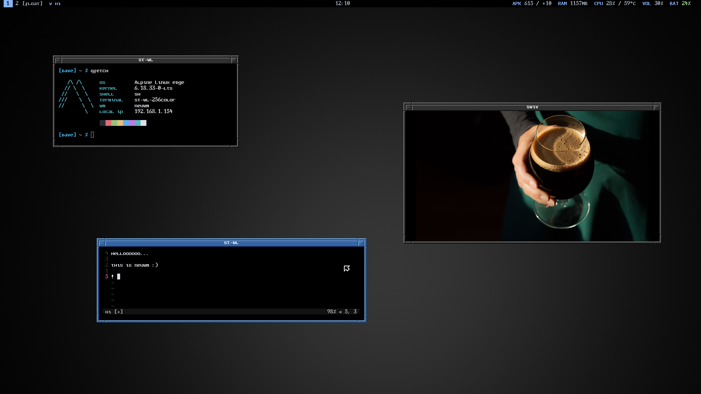

# neuwm
Originally based on [wsxwm](https://git.sr.ht/~uint/wsxwm) and borrowed heavily from [hevel](https://git.sr.ht/~dlm/hevel).

## Why

I wanted a compositor that combined the best parts of the projects I love — double borders, nein cursor, and smooth zoom/pan from [hevel](https://git.sr.ht/~dlm/hevel), and the keyboard-driven tiling/floating layout from [tohu](https://git.sr.ht/~shrub900/tohu) (itself a fork of [wsxwm](https://git.sr.ht/~unit/wsxwm)). Since `tohu` and `wsxwm` share the same base, `wsxwm` made the most sense as a starting point. `neuwm` is the result of pulling those features together into a single compositor.

## Inherited from wsxwm
- Tiling and floating window management
- Vanity gaps in tiling mode
- 9 virtual workspaces (see known issues)
- Per-window and global float/tile toggle
- Mouse move and resize for floating windows

## Borrowed from hevel
- Plan 9 nein cursor theme
- Double window borders
- Compositor zoom in/out via scroll wheel with smooth easing
- Draw-to-spawn terminals — press `mod+d`, drag to define window size

## Added in neuwm
- Resize height of stacked windows `mod+j/k`
- Cascading floating window placement with screen boundary awareness
- Global float toggle now remembers window positions and geometry
- Keyboard move and resize for floating windows
- Click to focus and reset zoom; hover focus suppressed while zoomed
- Pan canvas by dragging empty desktop with `mod+left-click`
- IPC support via [neuipc](https://codeberg.org/binkd/neuipc) — Unix socket at `/tmp/neuwm.sock`, `neuwmctl` CLI for querying and subscribing
- Alt+tab cycles focus between windows with smooth viewport pan to follow
- IPC `neuwmctl set_cursor cross|default` for cursor switching (used by `snapreg`)
- Keyboard repeat rate and delay configurable via `config.lua`
- Focused window geometry exposed via IPC (`neuwmctl get_focused`, `sub focused_geom`)

## Known issues
- Zoom and workspaces are incompatible due to a swc compositor limitation;
  hidden windows from other workspaces become visible when zoomed out.
  Workspace switching resets zoom but the underlying issue remains.

  #### An infinite canvas layout is planned to replace workspaces entirely in future releases.
  Alt+tab with viewport panning is an early step toward this — windows can be placed anywhere on the canvas and focused via keyboard.

## Dependencies

neuwm requires patched forks of neuswc and neuwld. It is hoped these patches will eventually be adopted upstream.

- [~pfr/neuwld](https://git.sr.ht/~pfr/neuwld) — patched neuwld with lazy shadow buffer allocation for correct rendering performance under software DRM
- [~pfr/neuswc](https://git.sr.ht/~pfr/neuswc) — patched neuswc with `swc_set_pan`, zoom layer exemption, and pointer fixes
- [neuipc](https://codeberg.org/binkd/neuipc) — lightweight Unix IPC library

Then the standard build dependencies:
- wayland-server
- libinput
- xkbcommon
- pixman
- libdrm
- libudev
- xcb
- xcb-composite
- xcb-ewmh
- xcb-icccm
- luajit (for Lua config support)

## Build & Install

```sh
muon setup build   # or: meson setup build
samu -C build      # or: ninja -C build
doas samu -C build install   # or: doas ninja -C build install
```
_muon and samu are preferred but meson and ninja are also supported._

## Launch
```sh
#!/bin/sh -e
export WLD_DRM_DUMB=1
export XDG_SESSION_DESKTOP=neuwm
swc-launch neuwm
```

## Configuration
Edit `~/.config/neuwm/config.lua`. Falls back to built-in defaults if missing.

## Decoration themes
Window decorations are provided by neuswc. To use them, clone the [decor](https://codeberg.org/shrub900/decor) collection and follow the per-theme `info` file for correct widths. Set the theme path in `~/.config/neuwm/config.lua`.

## IPC
neuwm exposes a Unix socket at `/tmp/neuwm.sock`. Use `neuwmctl` to query or subscribe:

```sh
neuwmctl get_workspace    # current workspace and max: "1 9"
neuwmctl get_workspaces   # current + workspaces with windows: "1 4 5"
neuwmctl get_mode         # tile or float
neuwmctl sub ws           # subscribe to workspace change events
neuwmctl sub mode         # subscribe to mode change events
```

## Keybinds
| Keybind | Action |
|---|---|
| `mod+return` | Terminal |
| `mod+space` | Menu |
| `mod+shift+e` | Quit |
| `mod+tab` | Focus next |
| `mod+shift+tab` | Focus prev |
| `mod+shift+j/k` | Rotate master |
| `mod+h/l` | Resize master |
| `mod+j/k` | Resize stack |
| `mod+t` | Toggle float (current window) |
| `mod+shift+t` | Toggle global float |
| `mod+f` | Fullscreen |
| `mod+shift+q` | Close window |
| `mod+1-9` | Switch workspace |
| `mod+shift+1-9` | Move window to workspace |
| `mod+arrows` | Move floating window |
| `mod+shift+arrows` | Resize floating window (left/top anchor) |
| `mod+ctrl+arrows` | Resize floating window (right/bottom anchor) |
| `mod+equal` | Scale floating window up |
| `mod+minus` | Scale floating window down |
| `mod+left-click` | Move window / pan canvas on empty space |
| `mod+right-click` | Resize window |
| `mod+scroll` | Zoom in/out |
| `mod+d` | Draw-to-spawn terminal mode |
| `mod+click` | Focus window / reset zoom |

## Tools & Extras

### swcsnap
Screenshots using neuswc's `swc_snap` protocol:
```sh
swcsnap image screenshot.ppm
```

Helper scripts are provided in the `tools/` directory:

- `snapreg` — interactive region screenshot using chum + ImageMagick
- `snapwin` — screenshot of the currently focused window
- `snapimg` — full screen screenshot
- `snaprec` — screen recorder using `swcsnap record` + ffmpeg, outputs MP4

Install them to your PATH:
```sh
doas install -m755 tools/* /usr/local/bin/
```

## Recommended

### Required for tools/
- [chum](https://git.sr.ht/~dlm/chum) — required for `snapreg` region selection
- ImageMagick (`magick`) — required for `snapreg` and `snapwin` cropping
- [swiv](https://git.sr.ht/~pfr/swiv) — opens screenshots after capture
- ffmpeg — required for `snaprec` screen recording

### Compositor stack
- [hst](https://git.sr.ht/~dlm/hst) — recommended terminal, pre-patched for neuwld
- [neumenu](https://git.sr.ht/~uint/neumenu) — dmenu fork for Wayland using neuwld
- [mojito](https://git.sr.ht/~dlm/mojito) — featherweight lemonbar-compatible bar for neuswc
- [neubar](https://git.sr.ht/~pfr/neubar) — event-driven status bar feeder for mojito with neuwm IPC support
- [wawa](https://codeberg.org/sewn/wawa) — minimal layer shell wallpaper setter
- [decor](https://codeberg.org/shrub900/decor) — window decoration theme collection for neuswc

## Screenshot


## Credits
- [~shrub900](https://git.sr.ht/~shrub900/)
  - [neuswc](https://git.sr.ht/~shrub900/neuswc)
  - [neuwld](https://git.sr.ht/~shrub900/neuwld)
- [~uint](https://git.sr.ht/~uint)
  - [wsxwm](https://git.sr.ht/~uint/wsxwm)
  - [neumenu](https://git.sr.ht/~uint/neumenu)
- [~dlm](https://git.sr.ht/~dlm)
  - [hevel](https://git.sr.ht/~dlm/hevel)
  - [mojito](https://git.sr.ht/~dlm/mojito)
  - [hst](https://git.sr.ht/~dlm/hst)
  - [chum](https://git.sr.ht/~dlm/chum)
- [sewn](https://codeberg.org/sewn)
  - [wawa](https://codeberg.org/sewn/wawa)
- [Michael Forney](https://github.com/michaelforney) for all of their amazing work, but specifically [swc](https://github.com/michaelforney/swc) & [wld](https://github.com/michaelforney/wld)

## License
neuwm is licensed with [unlicense](https://unlicense.org/), effectively putting it in the public domain. You are free to do whatever you please with this code.
